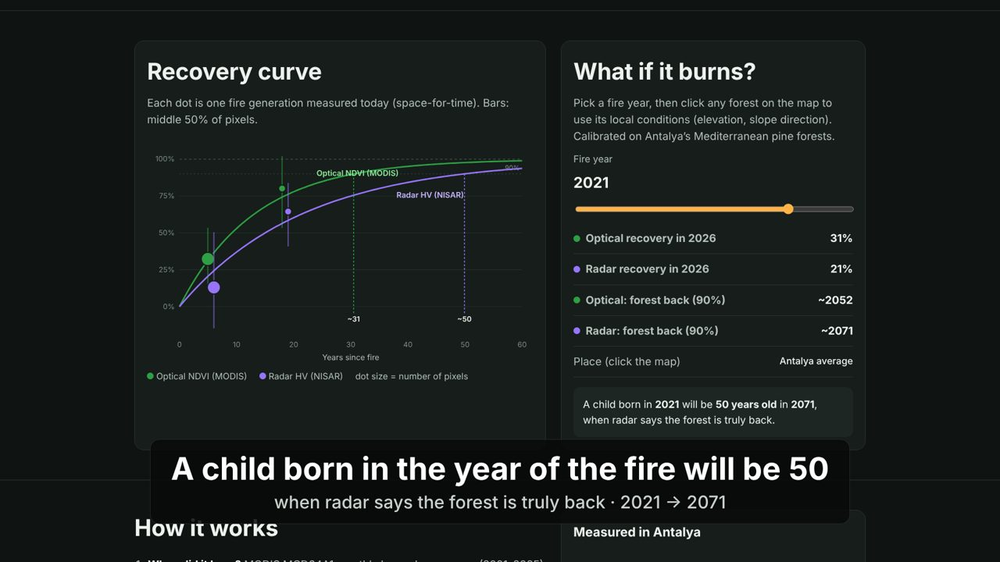
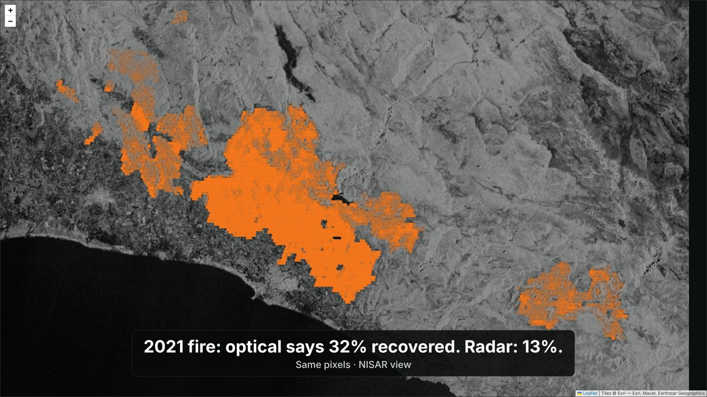

# The Green Illusion
### NISAR radar reveals when a burned forest is truly back

**NASA Space Apps Challenge 2026 · Challenge: _Dancing with the SARs_ · Antalya, Türkiye**

**Live app:** https://emrecakirr.github.io/green-illusion/ · **30-second demo:** [demo.mp4](https://emrecakirr.github.io/green-illusion/demo.mp4)

---

## The problem
After a wildfire, grass and shrubs turn green again within a few years. Optical satellites see this green and call the forest "recovered". But green is not a forest. Reforestation pledges, carbon accounting and recovery plans are often judged on how green a burn scar looks.

## Our idea
NASA-ISRO **NISAR** carries an **L-band radar** with waves about 24 cm long. They pass through leaves and bounce off **trunks and branches**, so the cross-polarized backscatter (HV) tracks woody structure, not color. We put both "eyes" on the same burned forests and measured the gap.

## Result (Antalya, real data)
| Fire (years ago) | Burned pixels | Optical recovery (NDVI) | Radar recovery (NISAR HV) |
|---|---|---|---|
| ~5 (2021 Manavgat) | 3,306 | **32%** | **13%** |
| ~18 (2008 Serik) | 869 | **80%** | **65%** |
| **Time to 90% recovery** | | **~31 years** (27.8–33.1) | **~50 years** (45.5–54.3) |

**The ~19-year gap is the Green Illusion.**

## What the app does
- **Two eyes, one forest:** a swipe comparison of MODIS NDVI and the NISAR HV image (20 Aug 2026) over Antalya.
- **See the illusion:** every burned 500 m pixel since 2001. A slider switches from the optical to the radar view. Click a pixel to see its burn year, its recovery by each sensor and its expected recovery year.
- **Recovery curves** fitted with a space-for-time approach.
- **"What if it burns?" calculator.** Click any forest and its local conditions (elevation, slope direction from NASADEM) adjust the forecast. Example: *a child born in 2021 will be 50 years old in 2071, when radar says the forest is truly back.*
- **Forecast map** of recovery time by local conditions.
- English and Turkish.

## Data
| Dataset | Use |
|---|---|
| **NISAR L2 GCOV** (PROVISIONAL, L-band, `NISAR_L2_PR_GCOV_028_108_D_070_…_20260820T164901`), [ASF DAAC](https://search.asf.alaska.edu/#/?dataset=NISAR) | HV/HH backscatter, woody structure |
| **MODIS MCD64A1 v061** burned area 2001–2025, [LP DAAC](https://www.earthdata.nasa.gov/data/catalog/lpcloud-mcd64a1-061) | Fire date of each pixel |
| **MODIS MOD13Q1 v061** NDVI, Aug 2026, [LP DAAC](https://www.earthdata.nasa.gov/data/catalog/lpcloud-mod13q1-061) | Optical greenness |
| **NASADEM** 30 m, [LP DAAC](https://www.earthdata.nasa.gov/data/catalog/lpcloud-nasadem-hgt-001) | Elevation, slope and aspect for local conditions |

## Method
1. Each 500 m pixel gets its last fire date (MCD64A1, June–October, 2001–2025).
2. Today's state comes from NDVI (Aug 2026) and NISAR HV/HH in dB (20 Aug 2026, about 500 m window average).
3. The reference is unburned forest within 5 km of the burns.
4. Space-for-time: value(t) = ref − (ref − v₀)·e^(−t/τ), with time to 90% = τ·ln10, and pixel bootstrap for uncertainty.
5. Local conditions: log(T90) is regressed on elevation, slope, north-facing and repeat burns, with a fixed effect per fire event. Within fires, every +350 m of elevation shortens radar recovery time by ~26%. The slope effect was excluded from forecasts because it is most likely a radar viewing-geometry artifact.

## Honest limits
- The curve rests mainly on two large fires, so the long-term part is an extrapolation.
- One NISAR date and one orbit direction; no terrain correction beyond the GCOV product.
- Pixel-bootstrap intervals are probably too narrow.
- The forecasts are calibrated for Antalya's Mediterranean pine forests.

**Next steps:** more NISAR dates and ascending orbits, fires in Muğla and İzmir, climate (GPM IMERG) and soil variables, and validation with forest inventory plots.

## Code
`analysis/` contains the full pipeline in Python 3.12:
- `01_veri_indir.py` downloads NISAR, MODIS burned area and NDVI.
- `01c_dem_indir.py` downloads NASADEM.
- `02_analiz.py` fits the recovery curves.
- `03_kosul_modeli.py` builds the local-conditions model.
- `04_gorseller.py` renders the map images.

Run them from a folder that contains a `data/` directory; a free NASA Earthdata login is required. The web app is static HTML/JavaScript with Leaflet.

## Credits
Emre Çakır. AI assistance: Claude (Anthropic) helped with code, analysis and text. All numbers come from the NASA data above. This is not an official NASA product, and no NASA logos are used. Basemap © Esri, Maxar, Earthstar Geographics.

Literature: Bousquet et al. 2022, *Biogeosciences* 19:3317; Tanase et al. 2011, *Remote Sensing of Environment*.
