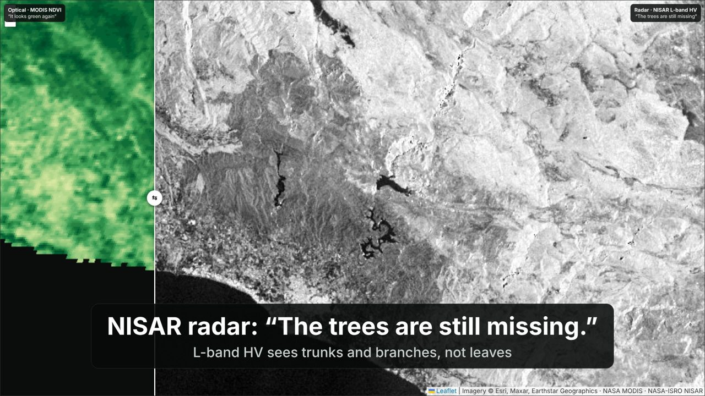
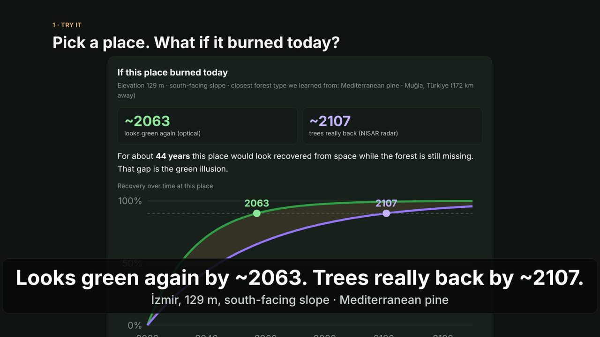
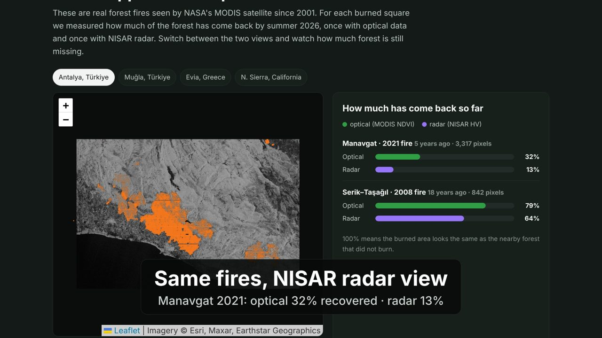

# The Green Illusion
**When does a burned forest really come back?**

NASA Space Apps Challenge 2026 · Challenge: *Dancing with the SARs* · Emre Çakır

**Live app:** https://emrecakirr.github.io/green-illusion/ · **30-second demo:** [demo.mp4](https://emrecakirr.github.io/green-illusion/demo.mp4)

## Why I built this
Every summer forests burn in Türkiye, Greece and California. A few years later the hills look green again, and most people assume the forest is back. Most of that green is grass and shrubs; the trees take much longer. Optical satellites, the ones most maps and reports rely on, see color and can be fooled by this. NASA-ISRO's new NISAR radar sees wood. I wanted to measure the difference, and turn it into something anyone can use.

## What the app does

1. **Try a place.** Click anywhere on Earth. The app reads the elevation and slope direction of that point, picks the most similar forest type we studied, and gives two dates for a fire today: when it will look green again from space, and when the trees will really be back.
2. **Look back.** 21,754 burned forest pixels from 27 fires in 4 regions (Antalya and Muğla (Türkiye), Evia (Greece) and the northern Sierra Nevada (California)). Switch between the optical view and the NISAR radar view, and click any burned square.
3. **Why radar.** A swipe comparison of the optical image and the real NISAR L-band image of the same hills, taken in the same weeks.
4. **How sure are we.** Every fire as a dot, the fitted recovery curves, the method and its limits.

## Main result
Across 14 fires in Mediterranean pine forests:
- Optical data say the forest is 90% back after **~31 years** (29–36).
- NISAR radar says **~67 years** (49–109).

For decades, a burned forest looks recovered from space while the trees are still missing. I call this the green illusion.

In **California's northern Sierra Nevada** (13 fires since 2001), optical data say ~13 years, but NISAR radar shows **no steady return of trees at all**: older burn scars are not more forested than younger ones. This matches field studies showing high-severity fires turning conifer forest into long-lasting shrub fields (Richter et al. 2019, *Ecosphere*, doi:10.1002/ecs2.2882). There the green illusion may be permanent unless people replant.

| Region | Fire | Years ago | Pixels | Optical recovered | Radar recovered |
|---|---|---|---|---|---|
| Antalya, Türkiye | 2021 (Manavgat) | 5 | 3,317 | 32% | 13% |
| Antalya, Türkiye | 2008 (Serik–Taşağıl) | 18 | 842 | 79% | 64% |
| Muğla, Türkiye | 2021 (Marmaris/Köyceğiz/Milas) | 5 | 2,484 | 34% | 10% |
| Muğla, Türkiye | 2022 | 4 | 272 | 19% | -46% |
| Muğla, Türkiye | 2025 | 1 | 103 | -20% | 12% |
| Evia, Greece | 2021 (North Evia) | 5 | 2,439 | 0% | 13% |
| Evia, Greece | 2019 | 7 | 135 | -87% | 70% |
| Evia, Greece | 2014 | 12 | 83 | -188% | 10% |
| Northern Sierra Nevada, California | 2020 (North Complex) | 6 | 5,973 | 75% | 60% |
| Northern Sierra Nevada, California | 2024 | 2 | 1,799 | 23% | 0% |
| Northern Sierra Nevada, California | 2021 (Dixie Fire) | 5 | 1,279 | 68% | 49% |

| Region | Burned pixels | Fires | Optical: 90% back | Radar: 90% back |
|---|---|---|---|---|
| Antalya, Türkiye | 4,275 | 2 | 30 yrs | 50 yrs |
| Muğla, Türkiye | 3,305 | 8 | 28 yrs | 101 yrs |
| Evia, Greece | 2,787 | 4 | no clear trend | 62 yrs |
| Northern Sierra Nevada, California | 11,387 | 13 | 12 yrs | no clear trend |
| **All Mediterranean pine regions** | 10,367 | 14 | **31 yrs** (29–36) | **67 yrs** (49–109) |
| **Sierra Nevada conifer** | 11,387 | 13 | **13 yrs** (10–25) | no clear trend (trees not returning) |

## Checking against field studies
Our satellite metric is not identical to what ecologists measure on the ground, so this is a check of direction, not an exact match. Independent field work points the same way as NISAR radar:
- **Spain, 25 years after the 1994 fires:** only 33 of 131 burned plots had reached a state similar to unburned neighbors in height, cover and biomass (Rodrigues et al. 2024, *Forest Ecology and Management*, doi:10.1016/j.foreco.2023.121587). At 25 years our optical curve says 84% recovered and our radar curve says 58%. The same study found better recovery on north-facing slopes and in wetter, cooler conditions, the same direction as our elevation effect.
- **Antalya, 2008 Serik–Taşağıl fire (in our data):** a five-year field study found no Turkish red pine regeneration in stands that were young when they burned, and concluded they would stay dominated by other woody plants without planting (Kavgacı et al. 2016, doi:10.3906/tar-1601-21).
- **Robustness, second radar view:** for Antalya I also processed the NISAR pass from the opposite orbit direction on the same day (20 Aug 2026). Pixel agreement is r = 0.85. Manavgat 2021 shows 13% vs 20% radar recovery, Serik 2008 64% vs 67%, and time to 90% is ~50 vs ~44 years. Both are far above the optical ~31.
- **California:** field studies document high-severity fires turning Sierra Nevada conifer forest into shrub fields (Richter et al. 2019, doi:10.1002/ecs2.2882), which is what NISAR shows there.

## Data (all free, all NASA unless noted)
- **NISAR L2 GCOV** (NASA-ISRO, L-band, PROVISIONAL, July–August 2026, one scene per region): [ASF DAAC](https://search.asf.alaska.edu/#/?dataset=NISAR)
- **MODIS MCD64A1 v061** burned area, 2001–2025: [LP DAAC](https://www.earthdata.nasa.gov/data/catalog/lpcloud-mcd64a1-061)
- **MODIS MOD13Q1 v061** NDVI, July–August 2026: [LP DAAC](https://www.earthdata.nasa.gov/data/catalog/lpcloud-mod13q1-061)
- **NASADEM** 30 m elevation: [LP DAAC](https://www.earthdata.nasa.gov/data/catalog/lpcloud-nasadem-hgt-001)
- In the browser, elevation for any clicked point comes from AWS Terrain Tiles; the basemap is Esri World Imagery.

## Method in short
1. MCD64A1 gives every 500 m pixel its last fire date.
2. For summer 2026 we take NDVI (greenness) and NISAR HV backscatter (woody structure), averaged over each 500 m pixel.
3. Reference = unburned forest within 5 km. 100% recovered = same as the neighbors.
4. **Space-for-time.** Fires of different ages, measured on the same day, become points on one curve: R(t) = 1 − e^(−t/τ), 90% at τ·ln10. For each forest type, the curve is fitted to fire medians, and the ranges come from a bootstrap that resamples whole fires.
5. **Local conditions.** NASADEM elevation and north/south aspect adjust the forecast. Higher forests recovered faster. A strong slope effect appeared too, but I left it out because it is most likely radar viewing geometry on steep terrain.

## Limits
- The long end of the curves is extrapolated; we do not have 50-year-old burns yet.
- One NISAR date per region from the first months of public NISAR data (Antalya: both orbit directions).
- Burn severity, soil and rainfall are not in the model yet.
- Forecasts far from the studied regions are rough guesses, and the app says so.

Next steps: more NISAR dates and both orbit directions, more regions, NASA GPM rainfall, and validation against forest inventory plots.

## Code
`analysis/` holds the full Python pipeline:
- `bolge.py`: region settings.
- `01_veri_indir.py`, `01c_dem_indir.py`: downloads.
- `02_analiz.py`: recovery curves.
- `03_kosul_modeli.py`: local conditions.
- `04_gorseller.py`: map images.
- `05_birlestir.py`: combines all regions into the web data.

You need a free NASA Earthdata login. The site is static HTML/JS with Leaflet (`index.html`, `app.js`, `gi_data.js`).

## Credits
Emre Çakır. I used Claude (Anthropic) as an AI assistant for code and text; all numbers come from the NASA data above. This is not an official NASA product, and no NASA logos are used.
Literature: Bousquet et al. 2022, *Biogeosciences* 19:3317; Tanase et al. 2011, *Remote Sensing of Environment*.
